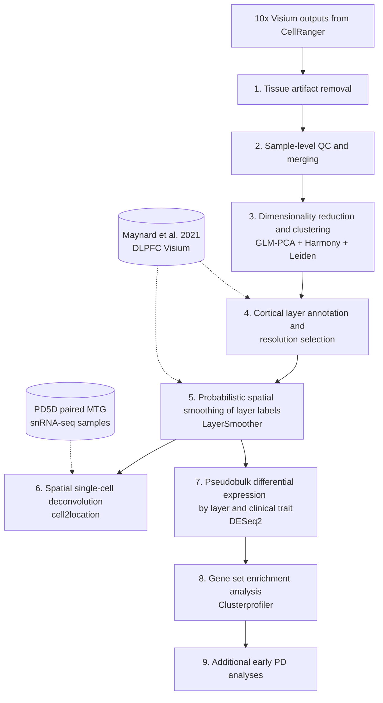

# mtg-spatial-transcriptomics

Analysis code for spatial transcriptomics of the human middle temporal gyrus (MTG) in Lewy body disease, generated as part of the Aligning Science Across Parkinson's (ASAP) PD5D project.

The data are 10x Genomics Visium sections of postmortem MTG from 96 samples across three diagnostic groups (32 control, 30 incidental Lewy body disease (ILBD), and 34 case). The pipeline assigns each spot to a cortical layer, refines layer boundaries with a spatial smoothing method (LayerSmoother), performs spatial cell-type deconvolution from paired single-nucleus RNA-seq data, and tests for layer-specific differential gene expression associated with Lewy body pathology.

## Pipeline overview

### 1. Tissue fold removal (`scripts/1_spatial_QC_fold_removal`)

An interactive Shiny app (`interactive_seurat/app.R`) for manually selecting and removing spots that overlap tissue folds, by clicking individual spots or dragging a box. `post_fold_removal_visualization.R` compares spot count distributions before and after removal.

### 2. Sample QC and merging (`scripts/2_sample_QC`)

`sample_qc_all_data.R` computes per-sample QC metrics and flags samples for exclusion. `post_qc_all_data_to_seurat.R` attaches clinical covariates to the retained samples and merges them into a single Seurat object. `st_clinical_overview.R` and `st_clinical_overview_3dplot.py` produce the clinical overview panels in Fig. 1.

### 3. Clustering (`scripts/3_clustering_pipeline`)

`spatial_clustering_pipeline.R` log-normalizes the merged data, selects variable features (removing genes detected too sparsely across samples and duplicated spot profiles), reduces dimensionality with GLM-PCA, integrates samples with Harmony (covariates: sample, sex, age, PMI, RIN), and clusters with the Leiden algorithm over a range of resolutions and three random seeds.

### 4. Layer annotation and validation (`scripts/4_post_clustering_validation`)

`select_cluster_resolution.R` chooses the clustering resolution by correlating each cluster's marker genes with the layer markers of Maynard et al. (2021) and by within-cluster dispersion (Supp. Fig. 1). Clusters are then assigned to cortical layers, and Layer 4 is separated from Layer 5 by subclustering. `recolor_spatial_layer_clusters.R` draws the layer UMAPs (Fig. 1f), and `maynard_corr_smooth_vs_unsmooth_only.R` and `layer_validation_maynard_figure.R` compare unsmoothed and smoothed layer labels against the Maynard markers.

### 5. LayerSmoother (`scripts/5_layer_smoothing`)

`gauss_kernel_convolution_cluster_smoothing.R` implements LayerSmoother, which refines cluster-based layer labels into spatially interpretable layers within each sample. It combines SVMs fit to spot coordinates with a Gaussian-kernel neighborhood score that orders spots along the cortical depth, and imputes remaining unassigned spots from their nearest neighbors. `maynard_layersmoother_validation/` applies the same procedure to the Maynard et al. DLPFC samples and compares the result against their manual layer annotations (Fig. 2, Ext. Data Fig. 2). `contour_depth_maps/` contains examples of the depth score.

### 6. Cell-type deconvolution (`scripts/6_cell2loc`)

`sc_seurat_export_counts.R` exports the spatial data to AnnData, and `sc_cell2loc_split_by_sample.py` runs cell2location against the paired MTG single-nucleus RNA-seq samples. `sc_seurat_merge_cell2location_props.R` merges the estimated cell-type abundances back into the Seurat object. The subfolders compare glutamatergic and GABAergic neuron abundances across layers and explore cell-type composition along cortical layers and pathology stage.

### 7. Differential expression (`scripts/7_deseq2`)

Counts are aggregated into pseudobulk profiles per sample and layer, and tested with DESeq2 likelihood ratio tests, adjusting for batch, PMI, RIN, sex, and age at death.

`pseudobulk_DE_DESeq2.R` tests each layer for association with neocortical (temporal) Lewy body pathology, brainstem (substantia nigra) pathology, last MMSE score, and motor UPDRS score. `pseudobulk_DE_DESeq2_unifiedLB_contilbd-case.R` tests diagnostic group contrasts (control vs. ILBD vs. case). `pseudobulk_DE_DESeq2_layer_vs_layer.R` identifies layer marker genes (each layer vs. all others). These scripts handle different types of covariate labels.

The subfolders contain downstream figures: layer marker heatmaps and boxplots, MA plots, variance partitioning between layers and individuals, effect-size comparisons across traits, and visualization of Xenium validation data.

### 8. Gene set enrichment (`scripts/8_gsea`)

`pseudobulk_DE_DESeq2_GSEA.R` runs fgsea on the DESeq2 statistics against KEGG and GO Biological Process gene sets, and `pseudobulk_DE_DESeq2_GSEA_clusterprofiler.R` provides a clusterProfiler-based alternative. `pseudobulk_DE_DESeq2_GSEA_vis_PCA_altdist_genelayercomb.R` clusters enriched pathways by leading-edge gene overlap and draws the combined dotplots and circular dendrograms. `gsea_leading_edge_mean_vs_diagnosis.R` plots leading-edge gene expression by diagnosis, and `compare_de_effects_to_refs.R` compares effect sizes with published PD studies.

### 9. Early PD analyses (`results/9_earlyPD`)

`scripts/8_gsea/earlyPD_nctx_vs_sn_de_gsea.R` compares MTG differential expression with substantia nigra results and between ILBD and case contrasts, and produces the gene-level barplots in Fig. 6.

## Software

Analyses were run in R 4.2 with Bioconductor 3.16. Key package versions:

| Package | Version | Used for |
|---|---|---|
| Seurat / SeuratObject | 4.3.0.1 / 4.1.3 | Data handling, normalization, clustering, visualization |
| SeuratWrappers | 0.3.1 | GLM-PCA and Presto wrappers |
| glmpca | 0.2.0 | Dimensionality reduction |
| harmony | 1.0.3 | Sample integration |
| leiden | 0.4.3 | Leiden clustering |
| presto | 1.0.0 | Fast marker gene tests |
| e1071 | 1.7-13 | Support vector machines in LayerSmoother |
| DESeq2 | 1.38.3 | Pseudobulk differential expression |
| fgsea | 1.24.0 | Gene set enrichment |
| clusterProfiler | 4.6.2 | Gene set enrichment |
| ggtree | 3.6.2 | Pathway dendrograms |
| ggplot2 | 3.4.2 | Plotting |
